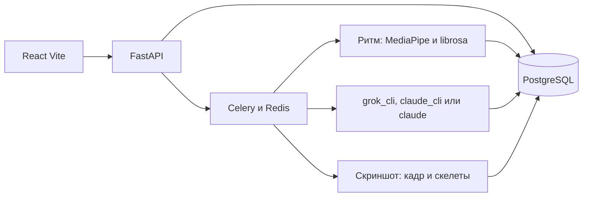

# Руководство разработчика

Как устроен код сейчас. Запуск, порты и переменные окружения — в [README.md](./README.md). Этот файл не заменяет [ARCHITECTURE.md](./ARCHITECTURE.md): тот документ фиксирует решения октября 2026 года, часть из них уже сменилась.

## Поток данных



1. `POST /api/videos/` сохраняет файл, создаёт видео и анализ со статусом ожидания и ставит `process_video_task`. Поле формы `subject` обязательно: `female`, `male` или `both`. Без него API отвечает 400: «Выберите, кого разбирать: девушку, мужчину или обоих партнёров». Выбор пишется в `analyses.subject`. У ошибки есть `errors.person` (`female` или `male`). Миграция `0004_analysis_subject`. Ритм по-прежнему видит одно тело MediaPipe: пол в промпте различается по внешности в кадрах, а не по красному скелету. Скриншот ошибки дополнительно читает `backend/data/models/pose_landmarker_lite.task` (до двух человек) и склеивает результат с повторным поиском pose solution. Если файла нет, остаётся только pose solution. При заметной разнице яркости груди светлая поза идёт девушке, тёмная — мужчине. Если выбран один человек, ошибки другого отбрасываются; пустая или чужая метка становится меткой выбранного. Для `both` остаётся только явная метка `female` или `male`.
2. Задача в `backend/app/tasks/video_tasks.py` считает ритм, при живом AI снимает 20 кадров и вызывает `get_ai_service().analyze_video`, склеивает ошибки, оставляет не больше 10 и рисует скриншоты.
3. Если AI недоступен, задача не падает: в анализ пишется текст ошибки, оценки AI остаются пустыми, ритм сохраняется.
4. `POST /api/analyses/{id}/save` переносит ролик в сохранённые. `DELETE` на анализе или видео удаляет файлы и строки.

Эталоны лежат отдельно от пользовательских роликов. `hasl_files` — 648 файлов, 647 уникальных имён. Позы — `backend/data/reference_poses/*.json`, компактный индекс — `backend/data/reference_index.json`. Дубликат `Препы-Омон-Харлей(вперед).MOV` не извлекается: рядом есть более тяжёлый `.mp4` с тем же именем элемента.

Пересборка:

```powershell
cd backend
.\venv\Scripts\Activate.ps1
python scripts\extract_all_references.py --yes --workers 6
python scripts\build_reference_index.py
```

## Где что лежит

| Путь | Зачем |
|---|---|
| `backend/app/api/` | HTTP: auth, users, videos, analyses |
| `backend/app/services/` | Ритм, позы, эталоны, визуализация, Grok CLI, Claude API и Claude CLI |
| `backend/app/tasks/` | Celery: разбор видео и очистка временных файлов |
| `backend/app/models/` | User, Video, Analysis, Error, TempUpload |
| `backend/app/schemas/` | Pydantic-ответы |
| `frontend/src/pages/` | Экраны |
| `frontend/src/services/api.ts` | Axios на `VITE_API_URL` или `http://localhost:8000` |

Провайдеры AI: `grok_cli` (подписка Grok, без ключа и без своего адреса), `claude_cli` и `claude`. Выбор — `get_ai_service()` в `backend/app/services/claude_service.py`.

У модели `Error` одно поле скриншота, `screenshot_path`. Второго пути к эталонному кадру нет: если поза каталога похожа, зелёный скелет стоит справа от кадра. Текст замечания в файл картинки не пишется.

## Соглашения

- Python: аннотации типов, докстринги на английском, строки для пользователя на русском.
- TypeScript: функциональные компоненты, пропсы через интерфейсы.
- Не хранить ключи в репозитории. `backend/.env` не коммитить.
- Миграции Alembic из каталога `backend`. Последняя ревизия на момент этой записи — `0003_user_display_name` (поле `users.display_name`).
- Тесты: из `backend` с активным venv команда `pytest`. Отдельных тестов фронтенда нет.
- Celery на Windows только с `--pool=solo`.

## Что легко сломать

- Импорт приложения не должен требовать живую базу: движок SQLAlchemy создаётся лениво.
- `mediapipe` в `requirements.txt` зафиксирован на 0.10.33. Код эталонов использует классический `mp.solutions`. Перед сменой версии проверьте, что этот API ещё есть.
- Сравнение поз учитывает соотношение сторон: вертикальный ролик пользователя и горизонтальный эталон нельзя сравнивать сырыми x/y.
- Индекс эталонов нужно пересобрать после новых JSON, иначе подбор примеров для AI смотрит в старый снимок.
- Клиент не использует прокси Vite. Запросы идут прямо на базовый URL Axios (`http://localhost:8000`, если не задан `VITE_API_URL`). Vite слушает `127.0.0.1:3000`, поэтому в `CORS_ORIGINS` входят и `http://127.0.0.1:3000`, и `http://localhost:3000`.
