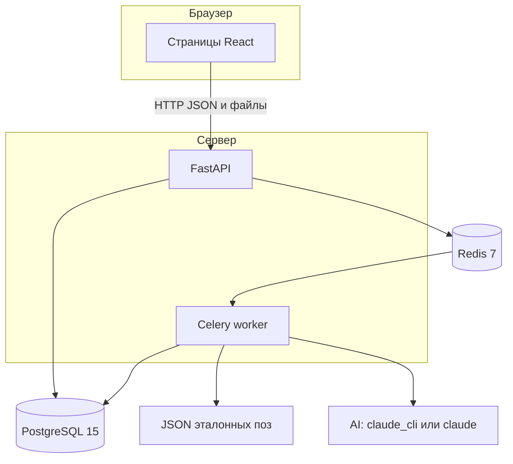

# Техническое описание для диплома

**Веб-сервис для анализа техники танца хастл с использованием искусственного интеллекта.**

Документ собран по коду репозитория на 13 ноября 2026 года. Цифры, которых нет в репозитории или в прогоне тестов ниже, здесь не приводятся.

## 1. Постановка

Танцору хастла нужна обратная связь по технике без постоянного присутствия тренера. Ручной разбор видео долгий. Сервис принимает ролик и возвращает оценки, список ошибок со временем и картинку, где поза пользователя сопоставлена с эталоном.

Аудитория — любители и продолжающие. Отдельных уровней подготовки в системе нет: разбор один и тот же.

## 2. Обзор решения

Пользователь регистрируется, загружает видео и ждёт разбор.

- Ритм считается локально: из ролика достаётся звук, librosa находит биты, MediaPipe находит позу и моменты шагов, шаги сравниваются с битами.
- Постура, техника и музыкальность запрашиваются у AI по набору кадров и уже посчитанному ритму. Провайдер задаётся `AI_PROVIDER`: официальный API Anthropic (`claude`) или локальный Claude Code CLI (`claude_cli`). В текущей конфигурации выбран `claude_cli`.
- Ошибки ритма и AI объединяются. В ответ попадает не больше 10, более серьёзные раньше. Для каждой строится один скриншот: кадр пользователя с красным скелетом и, если элемент узнан, зелёный скелет эталона на сером поле.
- Результат можно сохранить в историю аккаунта или удалить вместе с файлами.

Учебная база элементов — каталог `hasl_files`: 648 видеофайлов, 647 уникальных имён. По одному JSON поз на элемент лежит в `backend/data/reference_poses`. Файл `Препы-Омон-Харлей(вперед).MOV` не обрабатывался отдельно: это дубликат одноимённого `.mp4`. Индекс для быстрого подбора эталонов — `backend/data/reference_index.json`, в нём тоже 647 элементов.

## 3. Архитектура



Состав:

- Frontend: React 18, TypeScript, Vite, Material UI. Страницы: вход, регистрация, загрузка, обработка, результат, история, профиль.
- Backend: Python 3.11, FastAPI, SQLAlchemy 2, Alembic, Celery. База и брокер поднимаются Docker Compose. PostgreSQL на хосте слушает порт 5433, Redis — 6379.
- Таблицы: пользователи, видео, анализы, ошибки, временные загрузки.

Подробный маршрут для разработчика — [DEVELOPER_GUIDE.md](./DEVELOPER_GUIDE.md). Схема HTTP — раздел «API» в [README.md](./README.md) и живой Swagger на `/api/docs`.

## 4. Результаты проверок

13 ноября 2026 из каталога `backend` на Python 3.11.9 выполнено:

```powershell
.\venv\Scripts\python.exe -m pytest --tb=no -q --cov=app --cov-report=term-missing:skip-covered
```

Результат: **157 passed**, 6 предупреждений Pydantic о `class Config`, покрытие `app` **65%** (2364 строк, 830 не покрыты). Ниже всего покрытие у `rhythm_service.py`, `visualization_service.py` и `cleanup_tasks.py` (0%): эти модули в этом прогоне не вызывались. Выше 90% — `reference_service.py`, `claude_cli_service.py`, `image_text.py`, модели и `security.py`.

Отдельный факт по эталонам, проверенный подсчётом файлов 13 ноября 2026:

- видеофайлов в `hasl_files`: 648;
- уникальных имён и JSON поз: 647;
- элементов в индексе: 647;
- JSON с нулём поз: 0;
- JSON с долей найденных поз ниже 50%: один, `Пируэт-Райд(М)-Циферблат`, 90 поз из 372 кадров.

Более ранний сквозной прогон одного пользовательского ролика описан в [PROGRESS.md](./PROGRESS.md) (27 октября 2026): ритм 136 BPM, 94 бита, 37 шагов, точность 62,2%, MediaPipe увидел 1269 кадров из примерно 1278. Это результат того прогона, а не повторное измерение сегодня.

Сквозные тесты браузера в репозитории не автоматизированы. Скриншоты экранов в комплект документации пока не сняты: для них нужен поднятый Docker и открытый интерфейс.

## 5. Выводы

Сервис закрывает сценарий «загрузил видео — получил ритм, список ошибок и скриншоты» локальной обработкой и одним AI-провайдером. История и профиль строятся только по анализам, которые пользователь сохранил.

Ограничения, которые следуют из кода, а не из плана:

- без доступного AI оценки постуры, техники и музыкальности пустые, остаётся ритм;
- качество эталона `Пируэт-Райд(М)-Циферблат` низкое из-за слабой детекции позы;
- прогресс на странице обработки — оценка по времени, а не доля готовности от воркера;
- интерфейс не удаляет аккаунт, хотя API `DELETE /api/users/me` это делает.

